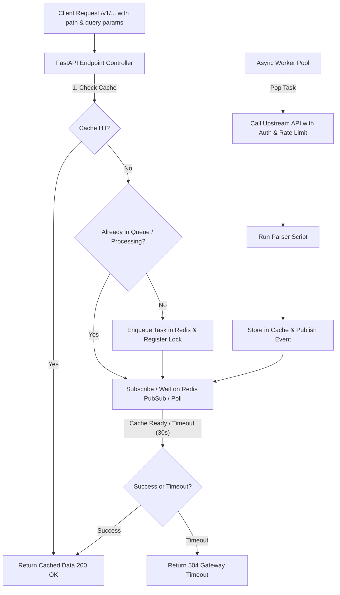

# Core Caching and Async Queue Architecture Design

**Spec**: `.specs/features/core-caching-queue/spec.md`
**Status**: Approved

---

## Architecture Overview

The system uses FastAPI for the REST API layer, Redis as a unified backing store (for caching, task queue, and request synchronization / PubSub), and an async worker process. The `definitions/` directory serves strictly as the **documentation and contract source of truth** (endpoints, upstream specs, schemas, and parsers). The application code is implemented statically and explicitly based on these documented contracts.



---

## Code Reuse & Contract Alignment (`definitions/`)

The implementation adheres strictly to the documentation defined in `definitions/`:
- **Endpoint Contracts (`definitions/resources/v1/*.yml`)**: Dictate URL paths, path parameters (`imdb_id`, `tmdb_id`), query parameters (`language`), cache key templates (`movie:imdb:{imdb_id}:{language}`), and co-located parser references.
- **Upstream Services (`definitions/upstream/*.yml`)**: Dictate base URLs (`https://api.themoviedb.org/3/`), authentication methods (`Bearer` token via environment variables), and rate-limiting policies.
- **Data Contracts (`definitions/schemas/*.json`)**: JSON Schemas governing the standardized movie resource model.
- **Domain Parsers (`definitions/parsers/*.py`)**: Python parser scripts transforming raw upstream responses into standardized models.

---

## Components

### 1. Cache Service (`src/services/cache.py`)
- **Purpose**: Abstracts Redis operations for storing and retrieving cached resource payloads and negative results using cache key patterns from definitions.
- **Interfaces**:
  - `async def get(key: str) -> Optional[dict]`
  - `async def set(key: str, value: dict, ttl: int = 86400) -> None`
  - `async def set_nx(key: str, value: str, ttl: int) -> bool`

### 2. Queue & Synchronization Service (`src/services/queue.py`)
- **Purpose**: Manages job queue insertion, task deduplication, and client waiting (via Redis PubSub / async polling).
- **Interfaces**:
  - `async def enqueue_or_wait(resource_key: str, fetch_func: Callable, timeout: int) -> dict`
  - `async def publish_ready(resource_key: str) -> None`

### 3. Upstream & Parser Service (`src/services/upstream.py`)
- **Purpose**: Implements explicit HTTP clients for upstream APIs (IMDb, TMDB) honoring rate limits, authentication (`TMDB_API_READ_ACCESS_TOKEN`), and invoking the respective parser module (`definitions/parsers/`).

### 4. API Endpoints (`src/api/v1/...`)
- **Purpose**: Explicit FastAPI route handlers implementing the endpoints documented in `definitions/resources/v1/`, supporting global `timeout` and resource-specific `language` parameters.

---

## Data Models

### Resource Cache Payload (`definitions/schemas/movie-v1.json`)
```python
from pydantic import BaseModel, Field
from typing import Optional, List

class MovieModel(BaseModel):
    id: str
    title: str
    original_title: Optional[str] = None
    year: Optional[int] = None
    genres: List[str] = []
    overview: Optional[str] = None
    rating: Optional[float] = None
```

---

## Error Handling Strategy

| Error Scenario | Handling | User Impact |
| -------------- | -------- | ----------- |
| Upstream API 404 | Cache negative result with short TTL (e.g., 300s) | Returns HTTP 404 to user |
| Upstream API Failure / Timeout | Release lock, record error, fail waiting tasks | Returns HTTP 502 Bad Gateway |
| Wait Timeout Exceeded | Stop waiting, return 504 | Returns HTTP 504 Gateway Timeout |
| Invalid Timeout Query Param | Fallback to default 30s | Request proceeds normally |

---

## Risks & Concerns

| Concern | Location (file:line) | Impact | Mitigation |
| ------- | -------------------- | ------ | ---------- |
| Redis connection drops | `src/services/cache.py` | API fails to serve cache or queue | Implement reconnection logic, circuit breaker, and graceful error handling. |
| PubSub message loss during high concurrency | `src/services/queue.py` | Waiters might hang until timeout | Combine PubSub notification with short-interval polling fallback. |

---

## Tech Decisions

| Decision | Choice | Rationale |
| -------- | -- | -- |
| Python Stack | FastAPI + Redis + `redis-py` async | High performance, excellent async support, low resource overhead. |
| Documentation Source of Truth | `definitions/` YAMLs, Schemas, & Parsers | `definitions/` serves as the explicit specification and contract documentation guiding static code implementation. |
| Synchronization | Redis PubSub + Polling fallback | Ensures zero missed notifications while maintaining responsiveness and minimal CPU usage. |
