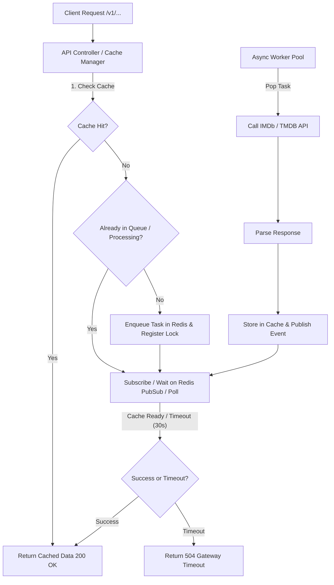

# Core Caching and Async Queue Architecture Design

**Spec**: `.specs/features/core-caching-queue/spec.md`
**Status**: Approved

---

## Architecture Overview

The system uses FastAPI for the REST API layer, Redis as a unified backing store (for caching, task queue, and request synchronization / PubSub), and an async worker process (or worker loop) to fetch and parse external data from IMDb and TMDB.



---

## Code Reuse Analysis

### Existing Components to Leverage
- Since this is a greenfield repository, there is no existing application code. We will establish clean architectural patterns (FastAPI dependency injection, Pydantic v2 validation, modular service layers, structured logging).

---

## Components

### 1. Cache Service (`src/services/cache.py`)
- **Purpose**: Abstracts Redis operations for storing and retrieving cached resource payloads and negative results.
- **Interfaces**:
  - `async def get(key: str) -> Optional[dict]` - Retrieves cached JSON data.
  - `async def set(key: str, value: dict, ttl: int = 86400) -> None` - Stores data with TTL.
  - `async def set_nx(key: str, value: str, ttl: int) -> bool` - Atomic distributed lock / deduplication marker.

### 2. Queue & Synchronization Service (`src/services/queue.py`)
- **Purpose**: Manages job queue insertion, task deduplication, and client waiting (via Redis PubSub / async polling).
- **Interfaces**:
  - `async def enqueue_or_wait(resource_key: str, fetch_func: Callable, timeout: int) -> dict` - Handles cache check, deduplication, queue push, and waiting for notification up to timeout.
  - `async def publish_ready(resource_key: str) -> None` - Signals waiting requests that cache is populated.

### 3. External API Client Service (`src/services/imdb_tmdb.py`)
- **Purpose**: Interacts with IMDb and TMDB APIs, parses raw responses into standardized models.
- **Interfaces**:
  - `async def fetch_resource(resource_type: str, identifier: str) -> dict` - Fetches from upstream APIs and parses.

### 4. API Endpoints (`src/api/v1/...`)
- **Purpose**: Exposes REST endpoints (movies, tv shows, search, id mappings) with query parameter handling (e.g., `?timeout=30`).

---

## Data Models

### Resource Cache Payload
```python
from pydantic import BaseModel, Field
from typing import Optional, Any

class CachedResource(BaseModel):
    id: str
    resource_type: str
    data: dict[str, Any]
    fetched_at: str
    ttl: int
```

---

## Error Handling Strategy

| Error Scenario | Handling | User Impact |
| -------------- | -------- | ----------- |
| Upstream API 404 | Cache negative result with short TTL (e.g., 300s) | Returns HTTP 404 to user |
| Upstream API Failure / Timeout | Release lock, record error, fail waiting tasks | Returns HTTP 502 Bad Gateway |
| Wait Timeout Exceeded | Stop waiting, return 504 | Returns HTTP 504 Gateway Timeout |
| Invalid Timeout Query Param | Fallback to default 30s | Request proceeds normally |

---

## Risks & Concerns

| Concern | Location (file:line) | Impact | Mitigation |
| ------- | -------------------- | ------ | ---------- |
| Redis connection drops | `src/services/cache.py` | API fails to serve cache or queue | Implement reconnection logic, circuit breaker, and graceful error handling. |
| PubSub message loss during high concurrency | `src/services/queue.py` | Waiters might hang until timeout | Combine PubSub notification with short-interval polling fallback. |

---

## Tech Decisions

| Decision | Choice | Rationale |
| -------- | -- | -- |
| Python Stack | FastAPI + Redis + `redis-py` async | High performance, excellent async support, low resource overhead. |
| Synchronization | Redis PubSub + Polling fallback | Ensures zero missed notifications while maintaining responsiveness and minimal CPU usage. |
